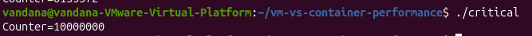
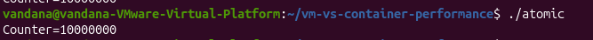
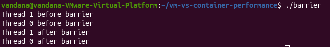
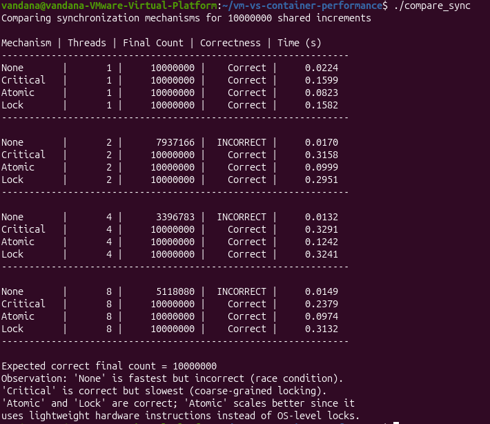
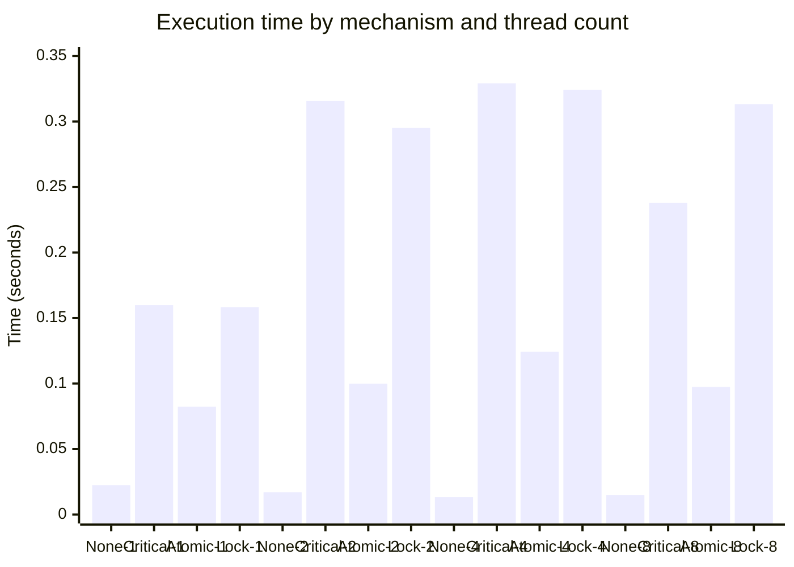
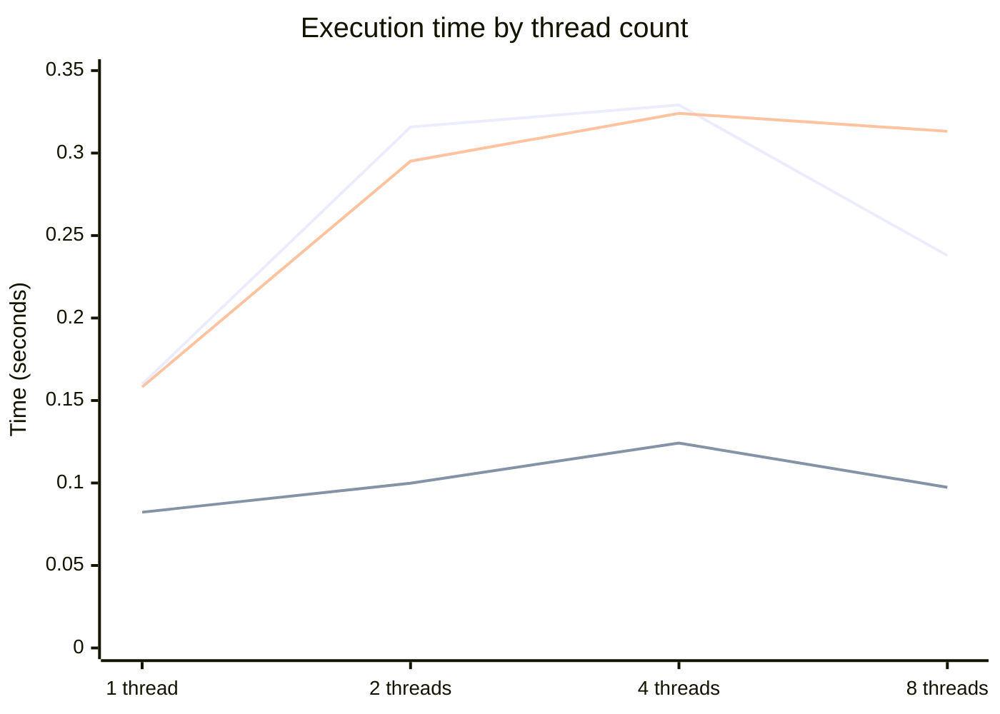

# PGC Experiment: Synchronization Mechanisms in Parallel Programs

## 1. Overview
This experiment demonstrates synchronization mechanisms used in parallel programs and compares their correctness and execution time.

## 2. Objectives
1. Observe how a race condition affects a shared counter.
2. Use synchronization mechanisms to protect shared data.
3. Verify whether each method produces the expected final count.
4. Compare execution times for different thread counts.

## 3. Software Requirements
- Ubuntu Linux
- GCC compiler
- OpenMP and POSIX thread support as required by the source programs

## 4. Source Programs

| File | Purpose |
|---|---|
| `race.c` | Demonstrates a race condition without synchronization |
| `critical.c` | Protects the shared counter using a critical section |
| `atomic.c` | Uses an atomic operation to update the shared counter |
| `barrier.c` | Demonstrates barrier synchronization between threads |
| `semaphore.c` | Protects a shared counter using a semaphore |
| `compare_sync.c` | Compares synchronization mechanisms for different thread counts |

## 5. Compilation and Execution
Use the compiler command required by each source file and your lab instructions. For an OpenMP source file, the typical command is:

```bash
gcc -fopenmp filename.c -o filename
```

Run the programs:

```bash
./race
./critical
./atomic
./barrier
./semaphore
./compare_sync
```

## 6. Program Outputs

The terminal screenshots are embedded below. The same original image files are also stored in the `screenshots/` folder.

### 6.1 Race Condition
Observed output: `Counter=6135572`. The count is below the expected 10,000,000 because concurrent updates can be lost when the shared counter is not protected.


### 6.2 Critical Section
Observed output: `Counter=10000000`.



### 6.3 Atomic Operation
Observed output: `Counter=10000000`.



### 6.4 Barrier Synchronization
Both threads print before and after the barrier. The order in which the threads print can vary between runs.



### 6.5 Semaphore
Observed output: `Counter=200000`.


### 6.6 Synchronization Performance Comparison
This screenshot contains the comparison output for 1, 2, 4, and 8 threads.



## 7. Benchmark Results

Values transcribed from the uploaded `compare_sync` terminal screenshot. Execution times are in seconds.

| Mechanism | Threads | Final Count | Correctness | Time (s) |
|---|---:|---:|---|---:|
| None | 1 | 10,000,000 | Correct | 0.0224 |
| Critical | 1 | 10,000,000 | Correct | 0.1599 |
| Atomic | 1 | 10,000,000 | Correct | 0.0823 |
| Lock | 1 | 10,000,000 | Correct | 0.1582 |
| None | 2 | 7,937,166 | Incorrect | 0.0170 |
| Critical | 2 | 10,000,000 | Correct | 0.3158 |
| Atomic | 2 | 10,000,000 | Correct | 0.0999 |
| Lock | 2 | 10,000,000 | Correct | 0.2951 |
| None | 4 | 3,396,783 | Incorrect | 0.0132 |
| Critical | 4 | 10,000,000 | Correct | 0.3291 |
| Atomic | 4 | 10,000,000 | Correct | 0.1242 |
| Lock | 4 | 10,000,000 | Correct | 0.3241 |
| None | 8 | 5,118,080 | Incorrect | 0.0149 |
| Critical | 8 | 10,000,000 | Correct | 0.2379 |
| Atomic | 8 | 10,000,000 | Correct | 0.0974 |
| Lock | 8 | 10,000,000 | Correct | 0.3132 |

## 8. Graphs

Both graphs are defined directly in this README using Mermaid; no separate graph folder is needed.

### 8.1 Execution Time Comparison



### 8.2 Execution Time of Synchronized Mechanisms



Series order in the second graph: Critical, Atomic, Lock.

## 9. Observations
1. Without synchronization, the final counter is incorrect when multiple threads update the shared variable.
2. Critical section, atomic operation, and lock produce the expected final count in the recorded comparison.
3. In this run, Atomic had the lowest execution time among the three synchronized methods for each tested thread count.
4. The unsynchronized version was fast, but its result was incorrect for 2, 4, and 8 threads.
5. Execution times can vary depending on the system and runtime conditions.

## 10. Conclusion
The experiment demonstrates that synchronization is necessary when multiple threads access and modify shared data. The race condition produced incorrect results, while the tested synchronization mechanisms maintained the expected final count. In this recorded benchmark, the atomic operation had the lowest execution time among the correct synchronized approaches.

## 11. Screenshot Files
All six terminal screenshots are stored in `screenshots/`:
- `race.png`
- `critical.png`
- `atomic.png`
- `barrier.png`
- `semaphore.png`
- `compare_sync.png`
